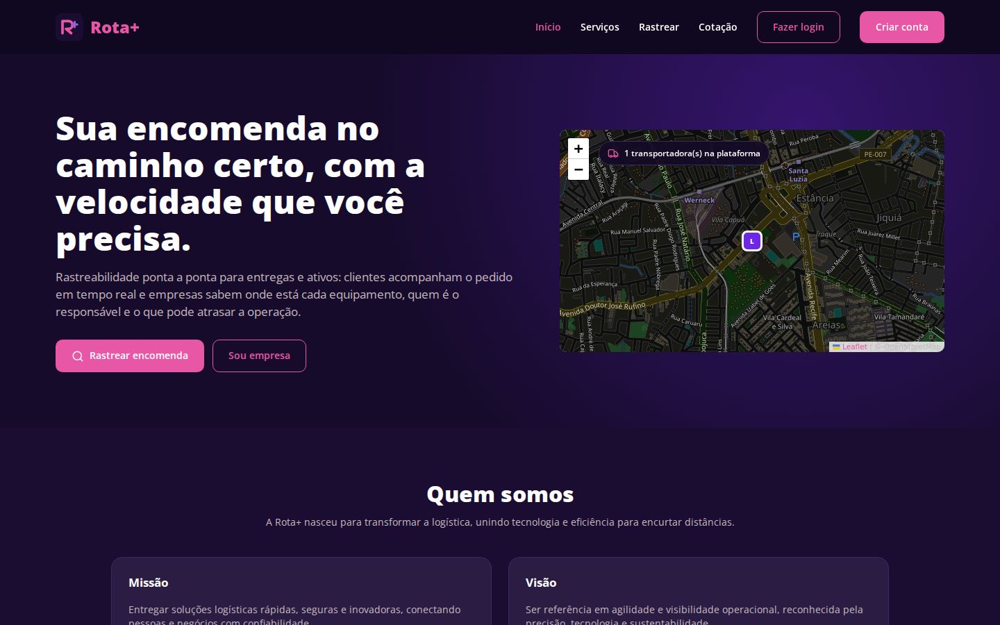
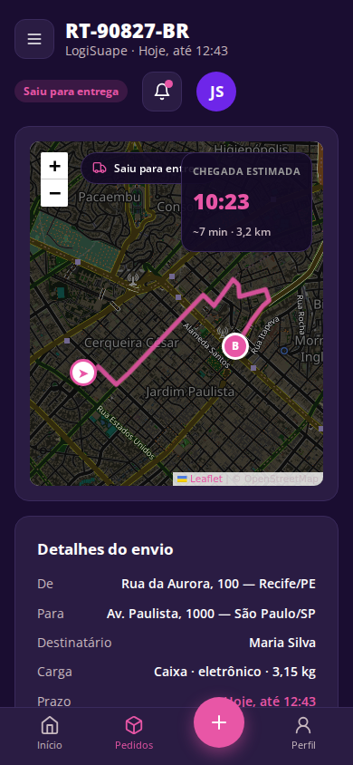
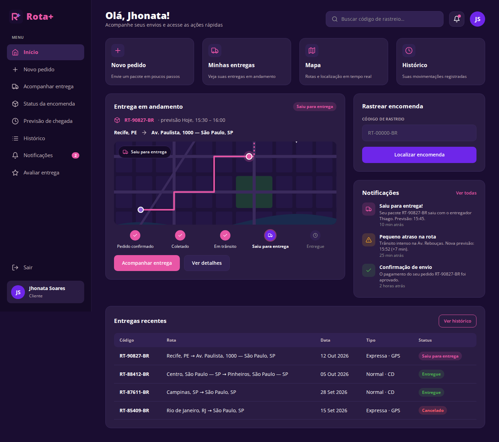
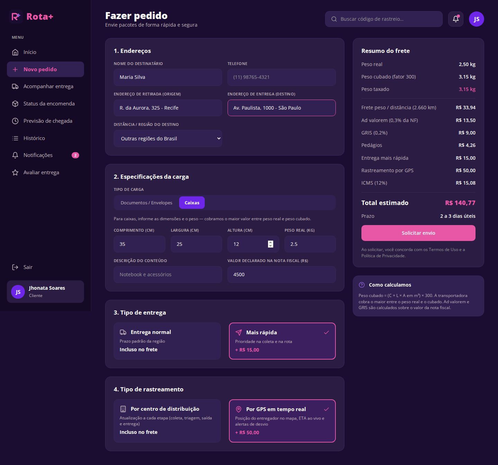
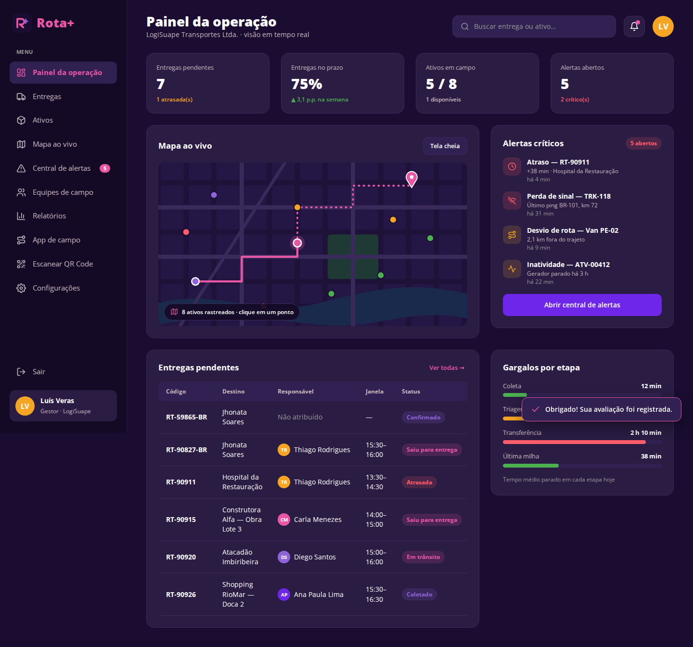
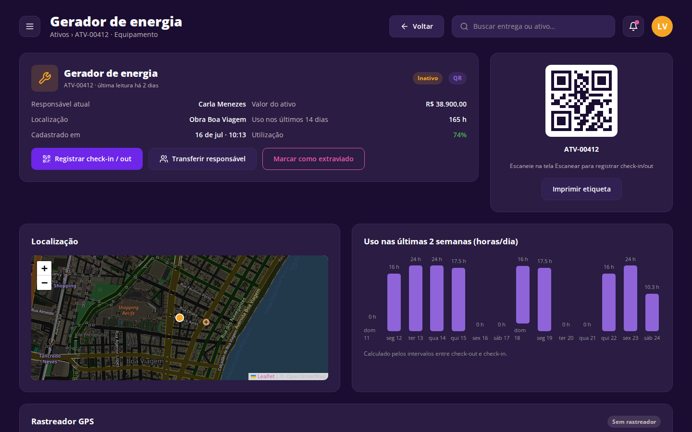
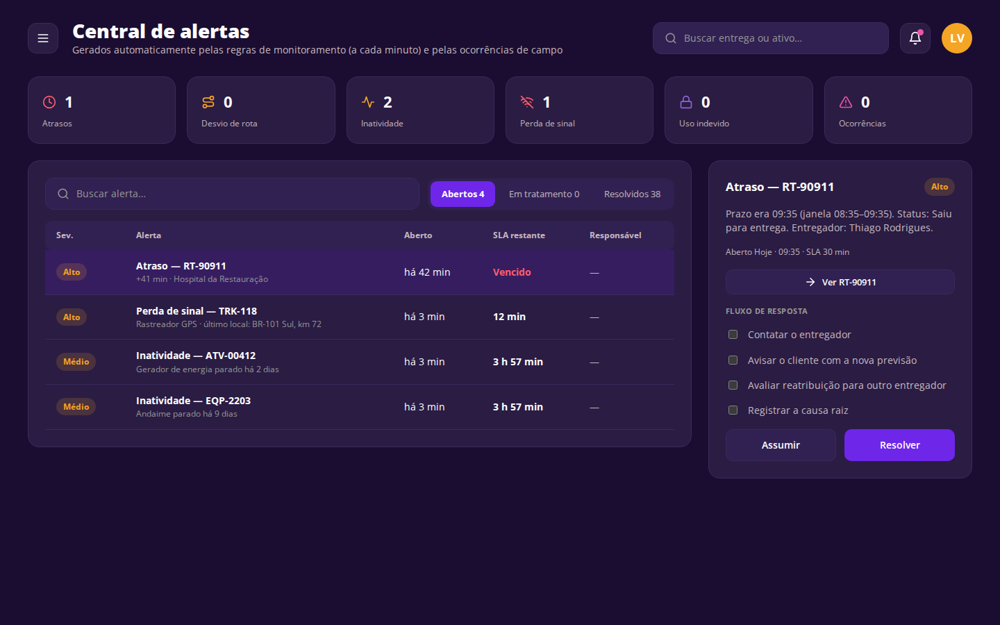
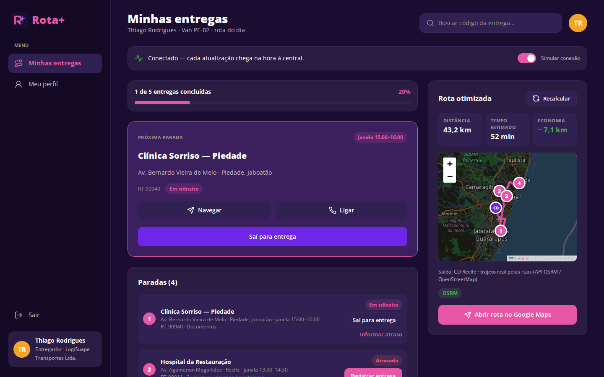

# Rota+ — Rastreabilidade de entregas e ativos

Aplicação web **full stack** (React + Node.js/Express + banco de dados **SQLite**) que dá visibilidade ponta a ponta sobre entregas, equipamentos, ferramentas, veículos e mercadorias. Ela atende tanto quem **envia ou recebe** uma encomenda quanto a **empresa** que gerencia a operação.



---

## Problema escolhido

**[Rastreabilidade de entregas e ativos](https://coreto.app.emprel.gov.br/banco-de-bo/rastreabilidade-de-entregas-e-ativos)**: desafio publicado pela Prefeitura do Recife no Banco de Desafios da plataforma C.O.R.E.T.O.

Empresas que dependem de mercadorias, equipamentos ou equipes externas em circulação têm dificuldade para saber, em tempo real:

- onde estão seus ativos;
- qual é o status das entregas;
- quem é o responsável por cada item;
- quais riscos podem afetar prazos e custos.

Muitas ainda dependem de ligações, mensagens e planilhas. O resultado são atrasos, perdas, extravios, retrabalho, conflitos com clientes e pouca previsibilidade. O desafio pede uma solução **acessível e adaptada a empresas de diferentes portes**, com:

- registro de localização, responsável, status e histórico de uso e movimentação;
- alertas de atraso, desvio de rota, inatividade, perda de sinal e uso indevido;
- painel com visão geral da operação, entregas pendentes, ativos disponíveis e gargalos;
- interface simples para as equipes de campo atualizarem o status;
- melhor comunicação com clientes;
- relatórios de desempenho;
- cuidados com LGPD quando o rastreamento envolve pessoas.

## Solução proposta

O **Rota+** é uma aplicação web responsiva, multiempresa, com quatro frentes:

| Frente | Para quem | O que resolve |
|---|---|---|
| **Site público** | Qualquer pessoa | Apresentação, cotação de frete, mapa das transportadoras e **rastreio sem login** (código + CPF/CNPJ), com mapa e previsão de chegada |
| **Área do cliente** | Quem envia ou recebe | Menu enxuto (Início, Meus pedidos, Meu perfil). Uma página por pedido com tudo junto. Pedido com escolha da transportadora e frete calculado no servidor, entregador no mapa com ETA real, conversa com o entregador, reagendamento, recado, comprovante (foto + assinatura), etiqueta com QR, notificações push e por e-mail, avaliação |
| **Visão operacional** | Administrador da empresa | Menu com 7 áreas: **Painel** (indicadores, mapa ao vivo com tela cheia, alertas, prazos e gargalos), **Entregas** (criação, importação CSV, atribuição, aviso por e-mail/WhatsApp), **Ativos** (QR/RFID/GPS, escanear, etiquetas, rastreador), **Central de alertas**, **Equipes** (convites, adesão, rota de cada entregador), **Relatórios** e **Configurações** (Empresa, Privacidade/LGPD, Integrações com caixa de saída) |
| **App do entregador** | Entregador da empresa | Só as entregas dele, na ordem da **rota otimizada**, GPS do aparelho, um botão por etapa, comprovante com foto, assinatura e localização, **fila offline** que envia sozinha ao reconectar |

### Separação por empresa (CNPJ)

Cada empresa é identificada pelo **CNPJ** (com validação dos dígitos verificadores) e tem seus próprios entregadores, entregas, ativos, alertas, relatórios e chaves de integração. Toda consulta do administrador e do entregador é filtrada pela empresa da sessão: uma empresa nunca vê os dados de outra. O cliente final tem uma conta só e pode pedir para qualquer transportadora.

- **Administrador**: cadastra a empresa (CNPJ único) e acessa a visão operacional.
- **Entregador**: entra por **link de convite** gerado pelo administrador (também por e-mail) ou informando o CNPJ da empresa. Acessa só o app de campo; a API também bloqueia o resto.

### Tudo em tempo real e com dados reais

- **Tempo real:** o servidor avisa o navegador por **Server-Sent Events** (`/api/eventos`) quando algo muda e a tela busca só o que mudou. Se a conexão cair, há uma busca de segurança a cada 60 s.
- **GPS:** o app do entregador usa a localização do aparelho (`navigator.geolocation`) e envia a posição para a API. O mapa ao vivo, o ETA do cliente e as regras de alerta usam essas posições.
- **Rastreadores:** veículos e equipamentos podem ter um rastreador (ou celular dedicado) que envia a posição com um token próprio.
- **QR e RFID:** as etiquetas têm QR Code real; a tela **Escanear** lê pela câmera (BarcodeDetector ou jsQR) e aceita leitores RFID/NFC/código de barras USB ou Bluetooth (modo teclado).
- **Mapas:** Leaflet + OpenStreetMap. Endereços são localizados pelo **Nominatim** (com cache); rotas e ETA pelo **OSRM**, com cálculo local quando não há internet.
- **Relatórios:** calculados no servidor a partir dos eventos, comprovantes, alertas e movimentações gravados (no prazo, tempo por etapa, utilização de ativos por check-out/check-in, alertas dentro do SLA, desempenho por entregador), com exportação CSV.
- **Alertas automáticos:** um monitor confere as regras a cada minuto — **atraso** (prazo vencido), **sem sinal** (entregador em rota ou rastreador sem GPS), **desvio de rota** (mais de 1 km do trajeto planejado), **inatividade** (ativo retirado há mais de 48 h sem leitura) e **uso indevido** (retirada ou movimento fora do expediente). O alerta se resolve sozinho quando a condição normaliza; cada tipo tem SLA e fluxo de resposta.
- **Notificações:** no app, **push do navegador** (Web Push), **e-mail** (SMTP) e **WhatsApp** (link wa.me com a mensagem pronta). Tudo o que sai fica na **caixa de saída**.

### Toda entrega é um ativo

Ao criar uma entrega, o sistema cria um ativo da categoria **Carga** (`CRG-…`), ligado à entrega. Status, local e responsável acompanham a entrega automaticamente. Os ativos são registrados pelo **tipo genérico** ("Caixa", "Gerador de energia", "Van de entrega"…), com a categoria (Veículo, Equipamento, Ferramenta, Carga) em coluna própria.

### LGPD

- Posições de pessoas só são aceitas **dentro do expediente** da empresa (o servidor recusa fora dele).
- **Termo de ciência** exibido ao entregador antes de ativar o GPS, com o aceite registrado.
- Histórico de localização de pessoas **apagado após 90 dias** (rotina automática).
- O cliente só vê a posição do entregador enquanto a entrega dele está a caminho, e a empresa pode desligar esse compartilhamento.
- O rastreio público não devolve documento, telefone, e-mail nem valor da nota.

### Como cada requisito do desafio foi atendido

| Requisito do desafio | Onde está no sistema |
|---|---|
| Localização, responsável, status e histórico do ativo | `Ativos` › ficha do ativo: mapa com a trilha do rastreador, uso em horas/dia, check-in/out, transferência, extravio; posição de tudo no mapa ao vivo do `Painel` |
| Alertas: atraso, desvio, inatividade, perda de sinal, uso indevido | Monitor automático + `Central de alertas` (SLA, fluxo de resposta, assumir, resolver) |
| Painel com visão geral, pendências, ativos disponíveis e gargalos | `Painel` (entregas em aberto, ativos em campo e disponíveis, mapa ao vivo, alertas, próximos prazos e gargalos medidos pelos eventos) |
| Interface simples para a equipe de campo | `App do entregador` (rota otimizada, um botão por etapa, comprovante, GPS, offline) e `Ativos › Escanear` (botão central no celular) |
| Comunicação com clientes | `Entregas › Avisar cliente`, rastreio público, link compartilhável, conversa, push, e-mail, WhatsApp, reagendamento, recado, avaliação |
| Relatórios de desempenho | `Relatórios` (7, 30 ou 90 dias) com CSV |
| LGPD e risco de controle excessivo | `Configurações › Privacidade (LGPD)` e `Equipes`: expediente, termo de ciência, exclusão após 90 dias, compartilhamento controlado |
| Empresas de diferentes portes | QR (barato), RFID ou GPS; vários CNPJs na mesma instalação |
| Integração com outros sistemas | `Configurações › Integrações` (API REST com chave, webhooks assinados, caixa de saída), `Entregas › Importar CSV`, entrada de rastreadores |

### Regras de frete (Novo pedido e Cotação)

- **Origem e destino:** 48 cidades reais, agrupadas por região. A distância é estimada pelas coordenadas (Haversine × 1,25, fator médio de estrada).
- **Prazo:** depende da distância (até 50 km: 1 dia; até 300 km: 1–2; até 1.000 km: 2–4; até 2.000 km: 3–5; acima: 4–7), contado em dias úteis no fuso da transportadora, até as 18:00.
- **Peso cubado** = (C × L × A em m³) × 300. O valor cobrado usa o **maior** entre o peso real e o cubado.
- **Tipo de entrega:** Normal ou **Mais rápida** (+ R$ 15,00). **Rastreamento:** por centro de distribuição (incluso) ou **por GPS** (+ R$ 50,00).
- **Taxas:** ad valorem (0,3% da NF), GRIS (0,2%), pedágios e ICMS (12%).
- O servidor **recalcula** frete e prazo com as mesmas regras; o valor mostrado no navegador é só a cotação.

---

## Tecnologias

**Front-end**
- **React 19**, **Vite**, **React Router** (`HashRouter`), CSS puro (variáveis, Grid, Flexbox)
- **Leaflet** + OpenStreetMap (mapas), **qrcode** (etiquetas), **jsQR** (leitura pela câmera quando o navegador não tem BarcodeDetector)
- **Service worker** (`public/sw.js`) para notificações push; **IndexedDB** para a fila offline do entregador

**Back-end e banco de dados**
- **Node.js + Express 5**: API REST em `/api`
- **SQLite** pelo módulo nativo `node:sqlite` (banco em arquivo, criado sozinho)
- Senhas com **scrypt** + salt; sessões por token com validade de 30 dias (renovada com o uso); limite de tentativas no login, cadastro e rastreio público
- **nodemailer** (e-mail), **web-push** (push), OSRM (rotas/ETA), Nominatim (endereços)

## Banco de dados

### Arquitetura

```
 Navegador (React) ──fetch /api──▶ Express (server/index.js) ──SQL──▶ SQLite (server/data/rota.db)
        ▲                               │  monitor.js (regras de alerta a cada 60 s)
        └──── SSE /api/eventos ◀────────┘  mensageria.js (e-mail, push, WhatsApp, webhooks)
```

### Tabelas (`server/schema.sql`)

| Tabela | Conteúdo |
|---|---|
| `empresas` | CNPJ, razão social, base (endereço e coordenadas), expediente, fuso, regras de LGPD, chave de API, webhook |
| `usuarios` | Clientes, administradores e entregadores (empresa, função, hash da senha, última posição GPS) |
| `sessoes` · `convites` | Tokens de login (com validade) e convites de entregador |
| `entregas` · `entrega_eventos` | Pedidos (prazo, janela, coordenadas, entregador) e a linha do tempo de cada um |
| `comprovantes` | Foto, assinatura, recebedor e GPS de cada entrega |
| `entrega_mensagens` · `entrega_contatos` · `ocorrencias` | Conversa, inscritos por e-mail no rastreio público e problemas reportados |
| `ativos` · `ativo_historico` · `ativo_movimentacoes` | Ativos, histórico e check-ins/outs (com leitura QR, RFID ou manual) |
| `posicoes` · `rotas_planejadas` | Posições GPS (entregadores e rastreadores) e a última rota otimizada de cada entregador |
| `alertas` · `alerta_passos` | Alertas (SLA, resolução automática ou manual) e o fluxo de resposta |
| `notificacoes` · `push_inscricoes` · `mensagens` | Notificações do app, navegadores inscritos no push e caixa de saída (e-mail/WhatsApp/webhook) |
| `configuracoes` · `sistema` · `geocache` | Preferências, chaves do push e cache de endereços |

### Endpoints principais

| Método e rota | Descrição | Acesso |
|---|---|---|
| `POST /api/auth/login` · `POST /api/auth/cadastro` · `GET /api/auth/convite/:token` | Entrar, criar conta, dados do convite | público |
| `GET /api/rastreio` · `GET /api/rastreio/acompanhamento` · `POST /api/rastreio/avisos` | Rastreio sem login (código + CPF/CNPJ), mapa/ETA, avisos por e-mail | público |
| `GET /api/eventos?token=` | Fluxo de tempo real (SSE) | logado |
| `GET/POST /api/entregas` · `POST /api/entregas/importar` | Listar, criar, importar CSV | por perfil / admin |
| `PATCH /api/entregas/:id/status` · `POST /api/entregas/:id/comprovante` | Status e comprovante (aceita registros feitos offline) | admin ou entregador designado |
| `GET /api/entregas/:id/acompanhamento` | Posição do entregador, ETA e trajeto | dono, admin, entregador |
| `GET/POST /api/entregas/:id/mensagens` · `POST /api/entregas/:id/aviso` | Conversa / aviso por e-mail ou WhatsApp | envolvidos / admin |
| `PATCH /api/entregas/:id/reagendar` · `/instrucoes` · `POST /ocorrencia` · `/avaliacao` | Ações do cliente | cliente dono |
| `GET /api/rotas/otimizada` | Rota otimizada (OSRM ou local) | entregador / admin |
| `POST /api/localizacao` · `GET /api/posicoes` | GPS do app / posições da equipe | entregador / admin |
| `/api/ativos…` | Cadastro, movimentação, transferência, extravio, rastreador, trilha | admin |
| `/api/alertas…` · `/api/relatorios` · `/api/relatorios/csv` | Alertas e relatórios | admin |
| `/api/empresa…` · `/api/equipe…` · `/api/convites` · `/api/mensagens` | Empresa, LGPD, API/webhook, equipe, caixa de saída | admin |

### API de integração (`/api/v1`)

Gere a chave em **Configurações › Integrações** e envie no cabeçalho `X-Api-Key`.

```bash
curl http://localhost:3001/api/v1/entregas \
  -H "X-Api-Key: rp_..." -H "Content-Type: application/json" \
  -d '{"cliente":"Loja Centro","destino":"Rua da Aurora, 100, Recife/PE","janela":"14:00–16:00","telefoneDestinatario":"(81) 99999-0000"}'
```

Rotas: `GET/POST /v1/entregas`, `GET /v1/entregas/:id`, `PATCH /v1/entregas/:id/status`, `GET /v1/ativos`.

**Webhooks:** cadastre uma URL e receba um `POST` a cada evento (`entrega.criada` e `entrega.status`, que inclui a entrega concluída com comprovante). O corpo vem assinado: `X-RotaPlus-Assinatura: sha256=<HMAC-SHA256 do corpo com o segredo whsec_…>`.

**Rastreadores GPS:** gere o token na ficha do ativo e envie:

```bash
curl -X POST http://localhost:3001/api/dispositivos/posicao \
  -H "X-Dispositivo-Token: trk_..." -H "Content-Type: application/json" \
  -d '{"lat":-8.0631,"lng":-34.8711,"velocidade":32,"bateria":87}'
```

## Responsividade

| Largura | Comportamento |
|---|---|
| ≥ 1024 px (desktop) | Sidebar completa + conteúdo em grid com coluna lateral |
| 768 – 1023 px (tablet) | Sidebar só com ícones; a coluna lateral desce para baixo do conteúdo |
| < 768 px (celular) | **Barra inferior** com botão central (+ Novo pedido / Escanear), menu lateral deslizante e **tabelas que viram cards** |

<p>
  
</p>

## Estrutura de pastas

```
rota-plus/
├── public/sw.js                 # service worker (push)
├── tests/api.test.js            # testes de integração da API (npm test)
├── server/
│   ├── index.js                 # Express: API, limite de tentativas e o site compilado
│   ├── db.js · schema.sql       # SQLite e tabelas
│   ├── seed.js · seedData.js    # empresa de demonstração com 30 dias de histórico
│   ├── auth.js · limite.js      # sessões, perfis, chave de API, limite de tentativas
│   ├── entregasServico.js       # criação, status, avisos, webhooks
│   ├── monitor.js · alertasServico.js  # regras de alerta automáticas
│   ├── mensageria.js            # e-mail, push, WhatsApp, webhooks
│   ├── tempoReal.js             # SSE
│   ├── geocode.js · rota.js     # Nominatim, OSRM, otimização local
│   ├── relatorios.js · uso.js   # indicadores calculados dos registros
│   └── routes/                  # auth, entregas, ativos, alertas, rotas, localizacao, geral, integracao (v1)
└── src/
    ├── services/api.js          # cliente HTTP
    ├── context/AppContext.jsx   # estado global + tempo real
    ├── hooks/                   # GPS, fila offline, acompanhamento, relatório
    ├── utils/                   # frete, datas, CSV, CPF/CNPJ, push, imagens (também usados pela API)
    ├── components/              # ui, layout, mapa (Leaflet), leitor (câmera/RFID), entregas
    └── pages/                   # publico, cliente, empresa, entregador, comum
```

---

## Como executar

**Pré-requisito:** [Node.js](https://nodejs.org/) **22.13 ou superior**. Não é preciso instalar banco de dados.

```bash
git clone https://github.com/guiniwer/rota-plus.git
cd rota-plus
npm install
npm run dev
```

Abra **http://localhost:5173** (a API fica na porta **3001**). Na primeira execução o banco é criado com a empresa de demonstração.

| Comando | O que faz |
|---|---|
| `npm run dev` | API (3001) + site (5173) em modo desenvolvimento |
| `npm run build` e `npm start` | Produção: um servidor só em **http://localhost:3001** com site + API |
| `npm run db:reset` | Recria o banco com os dados de demonstração |
| `npm test` | Testes de integração da API (banco temporário) |
| `npm run lint` | oxlint |

### Variáveis de ambiente (opcionais)

| Variável | Para quê |
|---|---|
| `PORT` | Porta da API (padrão 3001) |
| `APP_URL` | Endereço público do site, usado nos links de e-mail e convites |
| `DB_PATH` | Caminho do arquivo SQLite |
| `SMTP_HOST` · `SMTP_PORT` · `SMTP_USER` · `SMTP_PASS` · `SMTP_FROM` | Envio de e-mails. Sem elas, as mensagens ficam só registradas na caixa de saída |
| `VAPID_PUBLIC_KEY` · `VAPID_PRIVATE_KEY` · `VAPID_SUBJECT` | Chaves do push. Sem elas, o servidor gera e guarda um par no banco |
| `OSRM_URL` / `OSRM=off` | Servidor de rotas (padrão: OSRM público) / usar só o cálculo local |
| `NOMINATIM_URL` / `GEOCODER=off` | Servidor de endereços / não consultar a internet (usa o centro da cidade) |
| `MONITOR=off` · `MONITOR_INTERVALO_MS` | Desligar ou mudar o intervalo das regras de alerta |
| `SESSAO_DIAS` | Validade da sessão (padrão 30) |
| `TRUST_PROXY` | Atrás de proxy (Nginx etc.): use `true` para ler o IP real |
| `SEM_DEMO=1` | Não criar a empresa de demonstração num banco novo |

> Câmera, GPS e push só funcionam em **HTTPS** ou em `localhost`. Para usar no celular, publique o site com HTTPS.

### Contas de demonstração

| Perfil | Como entrar |
|---|---|
| Usuário (cliente) | aba **Usuário** → e-mail `jhonata@email.com`, senha `demo123` |
| Administrador | aba **Empresa** → **Demo: administrador** (e-mail `luis@logisuape.com.br`, CNPJ `12.345.678/0001-95`, senha `demo123`) |
| Entregador | aba **Empresa** → **Demo: entregador** (`thiago@logisuape.com.br`, mesmo CNPJ). Também existem `carla@`, `anapaula@`, `rafael@`, `jonas@` e `bruno@logisuape.com.br` |
| Rastreio sem login | menu **Rastrear** → código `RT-90827-BR` + CPF `123.456.789-09` |

A empresa de demonstração vem com 30 dias de operação gerados com datas relativas ao dia em que o banco foi criado. Para recomeçar: `npm run db:reset` ou **Configurações › Empresa › Restaurar dados** (só aparece na empresa de demonstração).

### Roteiro sugerido para avaliação

1. **Cliente:** faça um *Novo pedido* escolhendo a transportadora; ele abre na página do pedido, que reúne mapa, chegada estimada, entregador, etiqueta com QR e avaliação. O menu do cliente tem só **Início**, **Meus pedidos** e **Meu perfil**.
2. **Administrador:** o pedido aparece na hora em *Entregas* e em *Ativos › Carga*. Atribua ao **Thiago Rodrigues**. Veja *Relatórios* e o *Painel* com os indicadores dos últimos dias.
3. Em outro navegador, entre como **entregador** e permita a localização: a posição aparece no mapa ao vivo do *Painel* do administrador e o cliente passa a ver o ETA. Avance as etapas e registre a entrega com foto e assinatura. Desligue a internet do aparelho para ver a fila offline.
4. Em **Ativos**, imprima as etiquetas e leia uma pela câmera em **Ativos › Escanear** para fazer check-out/check-in.
5. Na **Central de alertas**, acompanhe os alertas que o monitor abre (ex.: entrega com prazo vencido) e resolva um.
6. Em **Equipes**, gere um convite e cadastre um entregador novo pelo link.
7. Em **Configurações › Integrações**, gere a chave da API e crie uma entrega com o `curl` acima.

## Capturas de tela

| Área do cliente | Novo pedido |
|---|---|
|  |  |

| Painel da empresa | Detalhe do ativo |
|---|---|
|  |  |

| Central de alertas | Tela do entregador (rota otimizada) |
|---|---|
|  |  |

---

## Equipe

- Arthur Vinícius — 01798631
- Güiniwer Mendes Buñol — 01783298
- Iderlan Fortaleza Arraes de Carvalho — 01779143
- Jhonata Soares Alves da Silva — 01796007
- Luís Simões Veras Filho — 01219274
