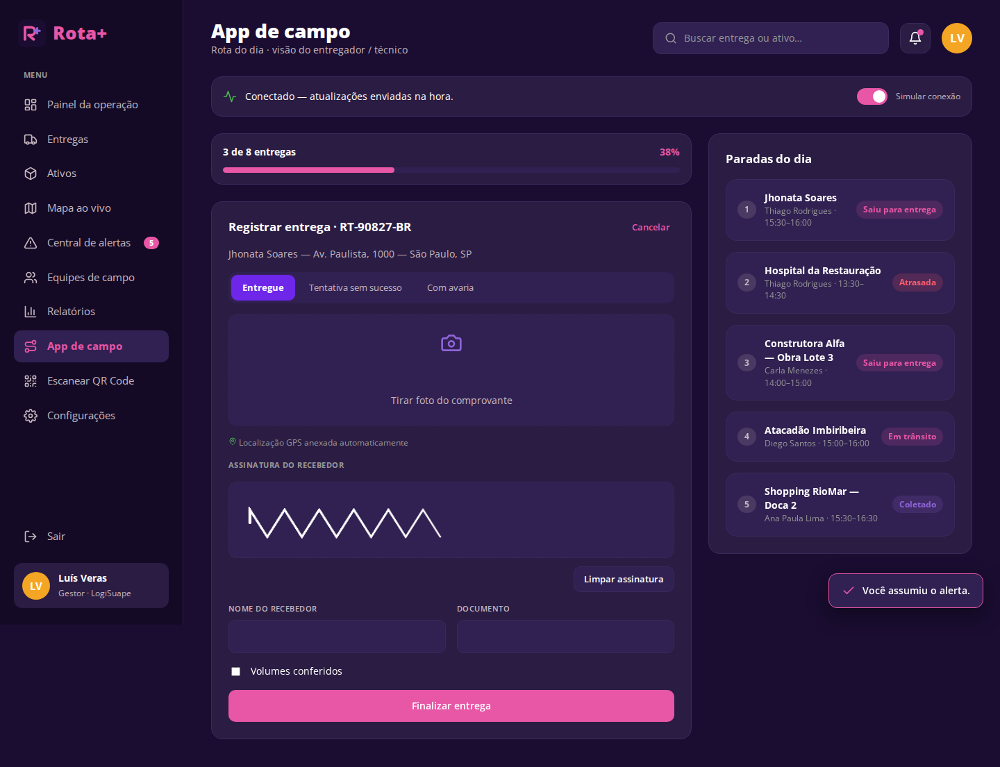

# Rota+ — Rastreabilidade de entregas e ativos

Aplicação web em **React** que dá visibilidade ponta a ponta sobre entregas, equipamentos, ferramentas, veículos e mercadorias. Ela atende tanto quem **envia ou recebe** uma encomenda quanto a **empresa** que gerencia a operação.


---

## Problema escolhido

**[Rastreabilidade de entregas e ativos](https://coreto.app.emprel.gov.br/banco-de-bo/rastreabilidade-de-entregas-e-ativos)**: desafio publicado pela Prefeitura do Recife no Banco de Desafios da plataforma C.O.R.E.T.O.

Empresas que dependem de mercadorias, equipamentos ou equipes externas em circulação têm dificuldade para saber, em tempo real:

- onde estão seus ativos;
- qual é o status das entregas;
- quem é o responsável por cada item;
- quais riscos podem afetar prazos e custos.

Muitas ainda dependem de ligações, mensagens e planilhas. O resultado são atrasos, perdas, extravios, retrabalho, conflitos com clientes e pouca previsibilidade. O desafio pede uma solução **acessível e adaptada a empresas de diferentes portes**, com:

- registro de localização, responsável, status e histórico de uso e movimentação;
- alertas de atraso, desvio de rota, inatividade, perda de sinal e uso indevido;
- painel com visão geral da operação, entregas pendentes, ativos disponíveis e gargalos;
- interface simples para as equipes de campo atualizarem o status;
- melhor comunicação com clientes;
- relatórios de desempenho;
- cuidados com LGPD quando o rastreamento envolve pessoas.

## Solução proposta

O **Rota+** é um site responsivo com três frentes:

| Frente | Para quem | O que resolve |
|---|---|---|
| **Site público** | Qualquer pessoa | Apresentação, cotação de frete e **rastreio sem login** (código + CPF/CNPJ) |
| **Área do cliente** | Quem envia ou recebe | Fazer pedido com cálculo de frete, acompanhar no mapa, ver previsão, histórico, notificações e avaliar a entrega |
| **Área da empresa** | Gestores e equipes de campo | Painel da operação, entregas, ativos (QR/RFID/GPS), mapa ao vivo, central de alertas com fluxo de resposta, equipes, relatórios, configurações (LGPD, integrações) e **app de campo** com comprovante (foto + assinatura) e modo offline |

O visual segue o protótipo feito no Figma (telas mobile originais + versões desktop).

### Como cada requisito do desafio foi atendido

| Requisito do desafio | Onde está no sistema |
|---|---|
| Localização, responsável, status e histórico do ativo | `Ativos` › `Detalhe do ativo` (histórico de movimentação, uso em horas/dia, check-in/out, transferência) |
| Alertas: atraso, desvio, inatividade, perda de sinal, uso indevido | `Central de alertas`, com contadores por tipo, prazo de resposta (SLA), checklist do fluxo de resposta, assumir e resolver |
| Painel com visão geral, pendências, ativos disponíveis e gargalos | `Painel da operação` |
| Interface simples para a equipe de campo | `App de campo` (rota do dia, registro com foto, assinatura e GPS, modo offline com fila de sincronização) e `Escanear QR Code` |
| Comunicação com clientes | Rastreio público, link de rastreio compartilhável, notificações, reagendamento e avaliação |
| Relatórios de desempenho | `Relatórios` (no prazo por período, utilização por tipo de ativo, alertas tratados) com exportação em CSV |
| LGPD e risco de controle excessivo | Rastreamento de pessoas só no expediente, termo de ciência e anonimização após 90 dias (`Equipes` e `Configurações`) |
| Empresas de diferentes portes | Identificação por QR (barato), RFID ou GPS, e planos por quantidade de ativos |
| Integração com outros sistemas | `Configurações › Integrações` (ERP, WMS, CSV, API/Webhooks, WhatsApp, CMMS) |

### Regras de frete (Novo pedido e Cotação)

- **Peso cubado** = (C × L × A em m³) × 300. O valor cobrado usa o **maior** entre o peso real e o peso cubado.
- **Tipo de carga:** Documentos/Envelopes (peso fixo) ou Caixas (com dimensões e peso).
- **Tipo de entrega:** Normal ou **Mais rápida** (+ R$ 15,00).
- **Tipo de rastreamento:** por centro de distribuição (incluso) ou **por GPS** (+ R$ 50,00).
- **Taxas:** ad valorem (0,3% da NF), GRIS (0,2%), pedágios e ICMS (12%).

---

## Tecnologias

- **React 19** com componentes funcionais
- **Vite** (build e servidor de desenvolvimento)
- **React Router** (`HashRouter`, que funciona em qualquer hospedagem estática)
- **HTML, CSS puro** (variáveis CSS, Grid e Flexbox, media queries) e **JavaScript (ES2023)**
- Sem bibliotecas de UI: todos os componentes foram feitos no projeto

### Recursos do React utilizados

- **`useState`**: formulários, filtros, abas, modais, paginação, estrelas da avaliação, modo offline etc.
- **`useEffect`**: contagem regressiva da previsão, simulação do veículo em movimento, atalho `Esc` no modal, persistência.
- **`useMemo`**, **`useRef`** (assinatura em `<canvas>`), **`useContext`** (estado global).
- **Hooks próprios:** `usePersistentState` (salva no `localStorage`), `useSimulatedProgress`, `useEntregaSelecionada`.
- **Props:** todos os componentes de UI são configurados por props (`Button variant`, `Badge tone`, `DataTable columns/rows`, `MapView markers/progress` etc.).
- **Eventos:** `onClick`, `onChange`, `onSubmit`, `onMouseEnter` (estrelas), eventos de ponteiro (assinatura), `keydown` global (fechar modal com `Esc`).

## Responsividade

| Largura | Comportamento |
|---|---|
| ≥ 1024 px (desktop) | Sidebar completa + conteúdo em grid com coluna lateral |
| 768 – 1023 px (tablet) | Sidebar só com ícones; a coluna lateral desce para baixo do conteúdo |
| < 768 px (celular) | **Barra inferior** com botão central (+ Novo pedido / Escanear QR), menu lateral deslizante e **tabelas que viram cards** |

<p>
  
</p>

## Estrutura de pastas

```
rota-plus/
├── index.html
├── public/favicon.svg
├── docs/screenshots/            # imagens usadas neste README
└── src/
    ├── main.jsx                 # ponto de entrada
    ├── App.jsx                  # rotas da aplicação
    ├── context/AppContext.jsx   # estado global + ações (pedido, check-in, alertas…)
    ├── hooks/                   # hooks personalizados
    ├── data/mockData.js         # dados de demonstração
    ├── utils/                   # regras de negócio (frete, status, formatação, mapa)
    ├── styles/                  # global, layout, componentes e páginas (CSS puro)
    ├── components/
    │   ├── ui/                  # Button, Card, Badge, Field, DataTable, MapView, Modal, Stepper…
    │   ├── layout/              # Sidebar, Topbar, BottomNav, Page, layouts público/logado
    │   └── entregas/            # componentes de domínio (badges de status, resultado de rastreio)
    └── pages/
        ├── publico/             # Landing, Login, Cadastro, Rastreio sem login
        ├── cliente/             # Início, Novo pedido, Acompanhar, Status, Previsão, Histórico, Notificações, Avaliar
        └── empresa/             # Painel, Entregas, Ativos, Detalhe do ativo, Mapa, Alertas, Equipes,
                                 # Relatórios, App de campo, Escanear, Configurações
```

---

## Como executar

**Pré-requisito:** [Node.js](https://nodejs.org/) 20 ou superior (com npm).

```bash
# 1. clonar o repositório
git clone https://github.com/guiniwer/rota-plus.git
cd rota-plus

# 2. instalar as dependências
npm install

# 3. rodar em modo de desenvolvimento
npm run dev
```

Abra o endereço mostrado no terminal (normalmente **http://localhost:5173**).

Para gerar a versão de produção:

```bash
npm run build     # gera a pasta dist/
npm run preview   # serve o build localmente
```

### Contas de demonstração

Não há back-end: o login é simulado e os dados ficam salvos no `localStorage` do navegador. Na tela de login, clique em **"Preencher com dados de demonstração"**:

| Perfil | Como entrar |
|---|---|
| Usuário (cliente) | aba **Usuário** → e-mail `jhonata@email.com`, senha `demo123` |
| Empresa | aba **Empresa** → e-mail `luis@logisuape.com.br`, CNPJ `12.345.678/0001-90`, senha `demo123` |
| Rastreio sem login | menu **Rastrear** → código `RT-90827-BR` + CPF `123.456.789-00` |

Para voltar aos dados iniciais, use **Empresa › Configurações › Dispositivos e plano › Restaurar dados**.

### Roteiro sugerido para avaliação

1. **Cliente:** faça um *Novo pedido* (troque Caixas/Documentos, Expressa e GPS e veja o frete mudar), depois veja o pedido em *Status* e *Acompanhar*.
2. Saia e entre como **Empresa:** o pedido aparece em *Entregas*. Atribua um responsável e mude o status.
3. Abra o **App de campo**, registre a entrega com foto e assinatura. Teste também desligando a "conexão" para ver a fila offline.
4. Em **Ativos**, abra o gerador `ATV-00412`, faça check-out/check-in e veja o histórico. Em **Escanear**, digite `ATV-00412`.
5. Na **Central de alertas**, marque etapas do fluxo de resposta, assuma e resolva um alerta.
6. Reduza a largura da janela para ver as versões tablet e celular.

## Capturas de tela

| Área do cliente | Novo pedido |
|---|---|
|  |  |

| Painel da empresa | Detalhe do ativo |
|---|---|
|  |  |

| Central de alertas | App de campo |
|---|---|
|  |  |

---

## Equipe

- Arthur Vinícius — 01798631
- Güiniwer Mendes Buñol — 01783298
- Iderlan Fortaleza Arraes de Carvalho — 01779143
- Jhonata Soares Alves da Silva — 01796007
- Luís Simões Veras Filho — 01219274
